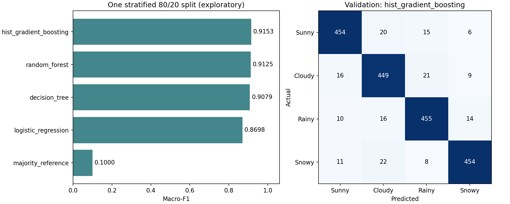
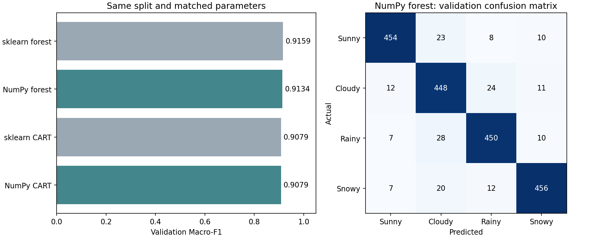

# weather-training-model

数据集 1 的天气四分类项目。包含 NumPy 手写 CART/随机森林、自主直方图混合模型、统一交叉验证、对照与消融、可复现预测和 CSV 校验。真实数据训练和 Kaggle 上传由使用者手动启动。

## 当前实验：第四轮长预算嵌套搜索

从仓库根目录的PowerShell执行，前三轮配置和结果保留：

```powershell
.\.venv\Scripts\python.exe -m pip install -r code/requirements-boosting.txt
.\.venv\Scripts\python.exe -X utf8 -B code/run_task1.py check --config configs/task1/fourth_run_search.json
```

确认检查后，使用者亲自执行才开始真实训练：

```powershell
.\.venv\Scripts\python.exe -X utf8 -B code/run_task1.py train --config configs/task1/fourth_run_search.json
```

固定比较9套完整配方：第二轮普通HGB、首轮自主权重HGB、RF100作为控制；另有2套正则化HGB、3套XGBoost和1套CatBoost。新HGB/CatBoost上限3000轮，XGBoost上限4000–5000轮。新提升模型只在允许训练数据内部选最佳轮数，再以该轮数重拟合完整训练部分；不会用外层验证集早停。所有实际轮数、参数和内部划分均留档。XGBoost已适配内部0–3标签与外部天气1–4标签。

显式`search`模式先完成9×5=45次共同折CV，再在每个外层训练部分执行9×3次内部CV，共180次`fit_model`调用；6种启用选轮的配方另需120次内部停止拟合，最后再拟合导出模型。这比前三轮耗时明显增加，没有静默截断或只比较部分完成配方。

`candidate_a`是开发OOF排序最高的单模型，`candidate_b`优先为最佳不同模型家族备选；**字母不再表示以前的“加权/普通”身份**。`training.export_models`仅为旧固定模式的共享字段，第四轮实际导出由明确搜索规则决定，记录在`selection.json`及`selected_config.json`。

自主融合只在外层交叉拟合中同时超过选模程序与最强固定单模型至少0.0005、且至少3/5折胜出时，另行导出`research_blend/submission.csv`；否则不会生成该上传候选。完整OOF学习的权重/类别倍率属于调参，嵌套值属于程序开发评估，门控也使用这些结果选型，不能当作独立测试或Kaggle分数。历史固定候选模式保持原行为。

```powershell
.\.venv\Scripts\python.exe -X utf8 -B code/run_task1.py results
```

第四轮所有CSV仍为整数1–4、3300条及表头，并完成读回/哈希/模型重载复现；平台分数须使用实际候选键`candidate_a`、`candidate_b`或已通过门控的`research_blend`手动记录。代码不会自动上传或推送。第三轮实际OOF普通HGB=0.915082，低于第二轮0.916810；第四轮尚未真实训练，0.92仍是目标而非已验证结果。个人说明不随代码上传。

## 手动启动第一次训练

从 `weather-training-model` 仓库根目录打开 PowerShell。数据放在仓库外的 `../Dataset/`，包含 `train.csv`、`test.csv`、`sample_submission.csv`。

首次安装（已有 `.venv` 时可直接检查）：

```powershell
python -m venv .venv
.\.venv\Scripts\python.exe -m pip install -r code/requirements.txt
```

先检查环境、配置和数据；`check` 不训练：

```powershell
.\.venv\Scripts\python.exe -B code/run_task1.py check --config configs/task1/first_run.json
.\.venv\Scripts\python.exe -B -m unittest discover -s code/tests -v
```

由使用者手动输入以下命令才会训练：

```powershell
.\.venv\Scripts\python.exe -B code/run_task1.py train --config configs/task1/first_run.json
```

流程为三种模型的共同五折评估，再将配置指定的两个候选全量重训、保存模型、导出 CSV、读回校验和重载复现。候选 A 为自主生成式训练权重 + HGB，候选 B 为同参数无权重 HGB；NumPy 随机森林作自主对照。默认不采用未显示稳健增益的学习权重融合。

程序只写本地文件，没有 Kaggle 上传或 Git 推送动作。输出目录在仓库外 `../local_artifacts/task1/<唯一run_id>/`，不覆盖历史结果。完成后查看路径：

```powershell
$taskRun = Get-Content ..\local_artifacts\task1\latest_training_run.json -Raw -Encoding UTF8 | ConvertFrom-Json
$taskRun.candidates
```

先查看程序打印的各候选本地指标，在课程竞赛的 **File Upload** 窗口手动选择对应的 `submissions/candidate_a.csv` 或 `candidate_b.csv`。程序会提示已导出候选中的本地OOF最高者，但不自动替换候选或上传，也不保证它在Kaggle更高。默认使用整数标签 `1/2/3/4`，包含 3,300 条预测和表头。评测器已明确拒绝英文 `Rainy`，提交样例中的英文标签不代表实际接受格式。新版 `check/train/finalize` 拒绝以英文或样例推断格式运行。旧版第一轮请直接上传已有的整数备用文件，无需重训。英文 `_name.csv` 仅供查看，不能上传评测。

查看最近一轮的实际本地分数与正确整数文件位置，不会训练：

```powershell
.\.venv\Scripts\python.exe -X utf8 -B code/run_task1.py results
```

`training_summary.json`、`comparison.csv`、`summary/` 图表和本地 manifest 为后续报告提供证据，不能将开发 CV 称为 Kaggle 成绩。上传报错也不是一个有效的 Kaggle 分数。

验证或记录上传后的真实成绩：

```powershell
$taskCandidate = Read-Host '实际上传的候选键，例如 candidate_a 或 candidate_b'
.\.venv\Scripts\python.exe code/run_task1.py validate-submission --submission $taskRun.candidates.$taskCandidate
$taskSubmissionId = Read-Host 'Kaggle实际提交编号'
$taskPublicScore = Read-Host 'Kaggle实际Macro-F1，小数点用英文句点'
.\.venv\Scripts\python.exe code/run_task1.py record-score --run-dir $taskRun.run_dir --candidate $taskCandidate --submission-id $taskSubmissionId --public-score $taskPublicScore
```

`record-score` 只保存本地人工记录，不查询或操作平台。相同配置/seed 重跑主要用于复现，不能保证分数提高。第二轮配置为 `configs/task1/second_run.json`：保持三条模型路线、权重算法、特征与划分不变，两套 HGB 从700增至1600轮，学习率0.03降至0.015，叶样本下限30增至40，L2从10增至15。手写100树森林保留为固定参照；更多树此前未显示稳定收益。

以下保留第二轮的手动复现命令；它增加训练并加强正则化，实际结果见下节。当前新实验使用下一节的`third_run.json`：

```powershell
.\.venv\Scripts\python.exe -X utf8 -B code/run_task1.py check --config configs/task1/second_run.json
.\.venv\Scripts\python.exe -X utf8 -B code/run_task1.py train --config configs/task1/second_run.json
```

参数直接在 JSON 的 `models` 中调整，无须修改模型实现。每个 HGB 的 `model_params` 可调 `max_iter`、`learning_rate`、`max_leaf_nodes`、`min_samples_leaf`、`l2_regularization`；加权模型的 `noise_weighting.floor` 控制最小样本权重；森林树数为 `n_estimators`。两个 HGB 的基础参数同步修改，以隔离样本权重的影响；保持验证seed不变做公平比较。

第一轮配置保留在 `first_run.json`。`iteration_leaf50.json` 是其他单因素研究预设，`stability_seed2026.json` 只核查划分稳定性。修改代码和共享配置前仍按新分支 → push → PR → 负责人审阅协作；个人调参配置可放仓库外，正式复现使用干净源码和明确配置哈希。

## 第三轮：固定120轮，手动启动

`configs/task1/third_run.json` 独立保存第三轮参数，保留前两轮配置。两套HGB均为 `max_iter=120`、`learning_rate=0.15`、15叶、最小叶样本40、L2=15，并关闭早停；自主权重floor仍为0.2，森林仍为100树参照。特征和五折/seed不变，候选A仍为加权、B仍为普通HGB。学习率增加是为了适配较少轮数，并非已验证提高成绩。

```powershell
.\.venv\Scripts\python.exe -X utf8 -B code/run_task1.py check --config configs/task1/third_run.json
.\.venv\Scripts\python.exe -X utf8 -B code/run_task1.py train --config configs/task1/third_run.json
```

HGB的120轮是120个提升阶段，四分类每阶段4棵小树；独立于权重生成器的30次EM上限和森林100树。`check`不训练；只有使用者执行`train`才启动真实数据拟合。

每次运行自动保存独立目录、`resolved_config.json`冻结参数、`run.json`轮次/标签/父运行/改动说明/双哈希、每折有效参数和实际迭代数、最终候选参数、源码/环境/数据/折哈希及可重放模型。`run.json`的`frozen_reproduce_command_template`引用该次快照，避免以后编辑原配置路径导致错复现。`results`会核验并显示这些记录；旧运行不虚构轮次。记录平台分数必须显式指定`--candidate`。

第三轮还在各HGB的`models/<模型名>/learning_curve.csv`和`.png`保存每10轮及首末轮的训练/验证Macro-F1、各验证类别F1和log-loss。它们只观察同一次已拟合模型，不追加训练、不自动选择轮数、不使用测试标签。曲线属于开发诊断；若据曲线再调参，后续成绩仍是模型选择估计。新增诊断会增加CV总耗时，比较效率时同时看原始fit_seconds和单列诊断耗时。

第二轮实际聚合结果见`results/task1/round2_20261106/`：普通HGB OOF=0.916810，加权HGB=0.915784。两轮证据不支持“轮数越多或加权必然更好”；0.92是争取的目标，并非已实现分数或老师的满分阈值。

## 统一入口与文件职责

- `code/run_task1.py`：`check/train/cv/nested/finalize/predict/validate-submission/record-score/results`。
- `code/task1/`：共用数据、折内预处理、模型工厂、验证、工件与提交校验；baseline/custom 共用这条新流程。
- `code/weather_models.py`：手写树/森林；增加可选叶概率平滑和原始属性分组采样，默认保留旧行为。
- `code/generative_weather.py`：自主直方图 NB 与共享污染成分 EM；第一候选用其训练责任度生成样本权重，测试推理只使用已训练 HGB。
- `configs/task1/`：共享模型参数与实验配方；`research_blend_*` 仅研究，外层结果未优于固定单模型，不是首次训练默认方案。
- `results/task1/`：经过校验的开发期聚合结果和图；原始数据、OOF、预测、模型、环境和私人计划留本地。

研究实验须另行手动启动，例如 `cv --config configs/task1/comparison.json`、`cv --config configs/task1/ablations.json`。CatBoost 比较额外安装 `code/requirements-boosting.txt`；首次训练不依赖 CatBoost。`code/requirements-lock.txt` 保存开发期完整依赖。macOS/Linux 使用 `.venv/bin/python` 替换上述解释器路径。

以下保留旧单次 Holdout 的历史参考，运行环境和验证协议与新流程不同，不能直接比较分数并宣称改进。

## 当前结果

训练集共 9,900 条记录，四类各 2,475 条；测试集共 3,300 条。包含 7 个数值属性和 3 个类别属性。未发现缺失值、训练集重复特征记录或训练与测试之间的相同特征记录。

固定随机种子 `5434`，采用一次分层 80% / 20% 划分，训练 7,920 条、验证 1,980 条。所有模型使用相同划分。

| 模型 | 验证集 Macro-F1 |
| --- | ---: |
| 多数类参照 | 0.1000 |
| 逻辑回归 | 0.8698 |
| 决策树 | 0.9079 |
| 随机森林 | 0.9125 |
| 直方图梯度提升树 | **0.9153** |

这些分数用于初步模型选择，尚未经过独立最终测试，也不是 Kaggle 成绩。完整参数、各类指标和混淆矩阵保存在 `outputs/dataset1_baseline/details.json`，计时结果保存在 `metrics.csv`。运行时间随硬件和环境变化。



## 自主实现结果

复用相同的分层 80% / 20% 划分和预处理，比较手写模型与参数一致的库模型。单树深度上限为 8、叶节点最少 5 条；森林使用 100 棵树、叶节点最少 2 条、每个节点随机考虑约 sqrt(p) 个编码后特征。

| 模型 | 验证集 Macro-F1 |
| --- | ---: |
| NumPy CART | 0.9079 |
| scikit-learn CART | 0.9079 |
| NumPy 随机森林（100 棵） | 0.9134 |
| scikit-learn 随机森林（100 棵） | 0.9159 |

此处两种森林均为 100 棵树；上面的早期基线森林为 300 棵树。完整实验记录见 `outputs/dataset1_custom/`，这些仍是单次验证划分的初步结果。



`code/weather_models.py` 的训练和预测只依赖 NumPy，自己实现了：

- 排序候选特征，用累计类别计数计算各切分点的加权 Gini 不纯度，选择最优二叉切分。
- 限制最大深度、最少叶节点样本和相对整棵树的最小不纯度下降；保留零增益切分以学习 XOR 等深层交互。
- 用叶节点的类别比例输出概率，批量遍历树进行预测。
- 对训练记录有放回抽样，在每个节点随机选择候选特征，平均各树的类别概率。
- 在抽样遗漏某类时保持全局类别顺序，避免概率列错位。
- 只使用未抽到某条记录的树计算该记录的袋外（OOB）预测。
- 按不纯度下降计算特征重要性，并汇总独热编码列对应的原始属性。

Bootstrap 重复记录按多次观测计数，叶节点样本下限也采用这个口径。随机数、并列切分的处理和抽样记账与 scikit-learn 存在实现差异，因此参数一致并不意味着树结构或预测完全相同。预处理、指标和对照模型仍使用 scikit-learn。

数学定义与算法参考：[决策树](https://scikit-learn.org/stable/modules/tree.html#mathematical-formulation)、[随机森林](https://scikit-learn.org/stable/modules/ensemble.html#forest)。

## 获取数据

通过课程指定的 Kaggle 比赛入口获取数据，在项目根目录建立以下目录：

```text
comp-5434-20261-project-task-1/
    train.csv
    test.csv
    sample_submission.csv
```

原始比赛数据和课程 PDF 不包含在仓库中。逐条记录的划分、验证预测、测试预测和概率文件在本地运行时生成，并由 `.gitignore` 排除。

## 运行

建议使用 Python 3.12。以下命令适用于 macOS / Linux，在仓库根目录运行：

```bash
python3 -m venv .venv
.venv/bin/python -m pip install -r code/requirements.txt
.venv/bin/python code/dataset1_baseline.py
.venv/bin/python code/dataset1_custom.py
.venv/bin/python -m unittest discover -s code/tests -v
```

指定其他数据位置或输出位置：

```bash
.venv/bin/python code/dataset1_baseline.py \
  --data-dir /path/to/dataset1 \
  --output-dir outputs/local_run
```

更多参数和输出说明见 `code/README.txt`，或运行：

```bash
.venv/bin/python code/dataset1_baseline.py --help
```

## 数据处理与验证

- `id` 只用于记录匹配，不作为模型特征。
- 缺失值填补、数值标准化和类别独热编码仅在当前训练部分拟合。
- 约 3% 的湿度或降水百分比记录超过 100；当前保留原值，清洗策略留待对比实验验证。
- 检查训练与测试字段、ID 唯一性、样例 ID、数值有效性和重复特征记录。发现训练集重复特征时停止，提示采用分组验证。
- 所有模型使用同一验证集，记录训练集与验证集 Macro-F1、各类指标、混淆矩阵及训练和预测时间。
- 以验证集 Macro-F1 最高的基线在完整训练集上重新训练，生成本地测试预测。
- 已核对原始文件哈希、训练和验证记录互不交叉、指标重算、概率和、预测行数与 ID 顺序；两次运行的划分、预测、概率和分数完全一致。计时不要求相同。

## 提交标签使用整数

训练集标签为整数：`1 = Sunny`、`2 = Cloudy`、`3 = Rainy`、`4 = Snowy`。虽然样例填写英文 `Rainy`，实际评测器已拒绝该字符串，因此上传文件必须用整数。

旧脚本生成 `baseline_predictions_integer.csv`，新统一入口默认同样输出整数。英文编码仅保留用于历史文件检查和语义哈希对照。程序不会自动提交比赛。

## 文件结构

```text
code/
    dataset1_baseline.py       数据检查、模型比较与预测生成
    dataset1_custom.py         手写模型与参数一致的库模型对照
    weather_models.py          只依赖 NumPy 的 CART 与随机森林
    tests/                     最优切分、边界、袋外预测和复现检查
    requirements.txt          固定版本的主要依赖
    README.txt                运行细节与本地输出说明
outputs/dataset1_baseline/
    audit.json                数据概况、检查结果和源文件哈希
    details.json              模型参数、各类分数及混淆矩阵
    metrics.csv               基线分数和计时
    data_overview.png          类别分布与百分比异常统计
    baseline_comparison.png    基线比较及最佳模型混淆矩阵
outputs/dataset1_custom/
    audit.json                数据检查与源文件哈希
    details.json              模型参数、结构、OOB 指标和计时
    metrics.csv               参数一致的手写模型与库模型分数
    feature_importances.csv   编码后特征的不纯度重要性
    original_feature_importances.csv  汇总至原始属性的重要性
    custom_comparison.png     分数对比和手写森林混淆矩阵
    feature_importance.png    手写森林的原始属性重要性
```

运行时还会生成本地环境信息、记录划分、逐条预测文件，以及 `custom_model.joblib`。手写模型脚本会重新加载保存的模型，核对测试概率完全一致。记录级文件和模型二进制文件均由 Git 忽略。原始 CSV 不会被覆盖。

## 后续工作

1. 使用交叉验证比较算法和参数，分析清洗策略与类别表现。
2. 比较单树、Bagging、随机特征和不同树数量，完成消融与效率实验。
3. 核对 Kaggle 标签编码，整理最终预测和小组报告材料。
